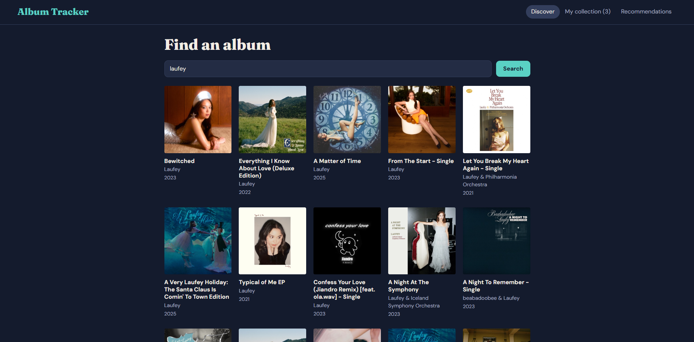

# Album Tracker

Album Tracker is a React web app for searching music albums, previewing their tracks, and keeping a personal listening log with statuses, 1-5 star ratings, and notes. It can play full albums through Deezer's embeddable player and suggests new albums with LLM-powered recommendations based on your saved albums and ratings.

<!-- Add your screenshot as screenshot.png in this folder, then it will show here -->


**Live site:** https://YOUR-APP.vercel.app

## Features

- Search albums and artists with the iTunes Search API (no key needed)
- Album page with cover, year, genre, track list, 30-second previews, and links to Spotify, YouTube, and Apple Music
- Mini player with play/pause, previous/next, and a seek bar that keeps playing while you browse
- My collection: status (Want to listen, Listening, Listened), star rating, notes, filter, and sort
- Optional full-album playback with Deezer's player
- LLM-powered recommendations based on the user's saved albums and ratings

## Tech Stack

React, Vite, Context API, iTunes API, Deezer, Gemini, Vercel

## Run Locally

```bash
git clone https://github.com/YOUR-USERNAME/YOUR-REPO.git
cd YOUR-REPO
npm install
# create a file named .env.local in the project root containing:
# GEMINI_API_KEY=your-key-here
npm run dev
```

## Limitations

- Previews are 30 seconds, because that is all the iTunes API provides
- The collection is saved only in your browser (localStorage)
- Deezer needs a login (and a plan that includes full tracks in your country) for full tracks

## Privacy

The recommendations feature sends your saved albums' titles, artists, ratings, and statuses to Google's Gemini API. Your notes are not sent.

## Disclaimer

This is a learning project and is not affiliated with Apple, Spotify, Deezer, or Google. Music data, artwork, and audio belong to their owners.
